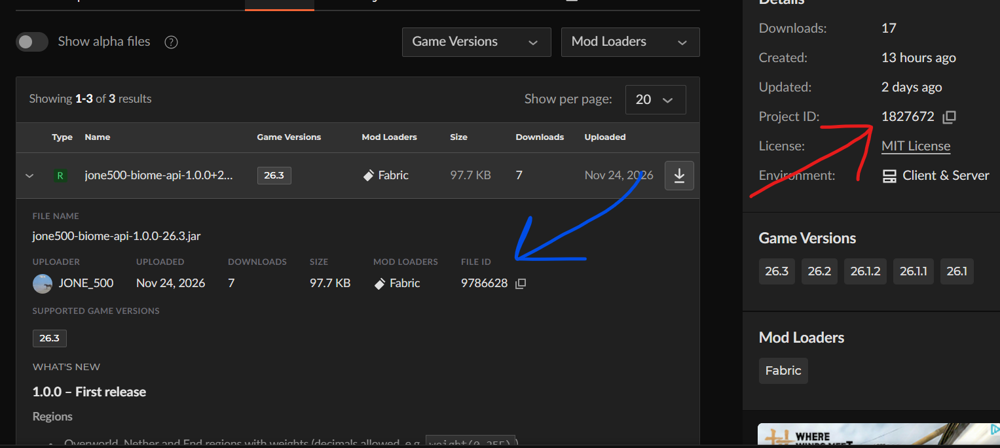

# JONE500 Biome API

A Fabric library for **Minecraft 26.3** that adds your Overworld, Nether and End biomes in **regions**:

- **Deterministic:** regions are sorted by id, so the same seed always gives the same world, no matter
  in which order mods load.
- **Per-patch rolls:** a replacement can happen in only part of your region's patches
  (e.g. 30%), so your biomes don't all appear at once.
- **Exclusive biomes:** "at most one of these biomes in the same patch".
- **Decimal weights:** very rare regions are possible (`weight(0.25F)`).
- **Many biomes by weight:** "nether wastes become 5 of my biomes, 5 : 3 : 1 : 1 : 1" with `WeightedBiomes`, no climate needed (great for the Nether and the End).
- **World-wide replacement:** "30% of all forests become my biome", or "in 50% of worlds, every cherry grove is my biome" (also caves and oceans), without a region.
- **Strict climate:** your inland biome never shows up in the sea.
- **Surface rules** for your biomes (which blocks make up the ground).

Works in the **Overworld**, the **Nether** and the **End** (regions and replacements; in the End also with Fabric API's placement).

## How it works (short)

The Overworld is split into big patches (about 512 blocks apart). Each patch is either vanilla or one of
the registered regions, picked by weight (vanilla = 10). Inside your region the terrain and climate are
exactly vanilla, but the vanilla biomes you replaced become your biomes.

> **Learn from code:** [`src/tutorial`](src/tutorial/java/net/biome/tutorial) is a complete mod that uses Biome
> API, one lesson per file with comments: your first region, a region with only your own climate values (no replace,
> `strict()`, a cave biome), exclusive biomes, world-wide replacements, surface
> rules, the Nether, the End, and making biomes with `BiomeMaker` in data generation. Start with
> [`TutorialMod.java`](src/tutorial/java/net/biome/tutorial/TutorialMod.java).

## 1. Add it to your mod

```groovy
repositories {
    exclusiveContent {
        forRepository { maven { name = "Modrinth"; url = "https://api.modrinth.com/maven" } }
        filter { includeGroup "maven.modrinth" }
    }
}

dependencies {
    implementation "maven.modrinth:jone500-biome-api:1.1.0+26.3"
}
```

`fabric.mod.json`:

```json
"depends": {
    "jone500-biome-api": ">=1.0.0"
}
```

### Getting Biome API from CurseForge instead (CurseMaven)

Biome API is also on [CurseForge](https://www.curseforge.com/minecraft/mc-mods/jone500-biome-api).
CurseForge has no Maven of its own, so you use **CurseMaven**, a free service that turns CurseForge
files into Gradle dependencies. Use it in place of the Modrinth repository above (you don't need
both).

**1. Find the file ID.** On CurseForge, open **Files**, click the file for **your** Minecraft
version, and copy the **File ID** number. Each Minecraft version has a different file ID.



- **Project ID** (red arrow, in the box on the **right** side of the page): `1827672`. The same for
  every file.
- **File ID** (blue arrow, in the file's details, under **FILE ID**): `9786628` in the picture (the
  1.0.0 file for 26.3). Different for every file. The small button next to each number copies it.

Biome API 1.1.0 files:

| Minecraft | File ID |
|---|---|
| 26.3 | `9840696` |
| 26.2 | `9840692` |
| 26.1 | `9840689` |

**2. Add CurseMaven to `build.gradle`:**

```groovy
repositories {
    exclusiveContent {
        forRepository {
            maven {
                name = "CurseMaven"
                url = "https://cursemaven.com"
            }
        }
        filter {
            includeGroup "curse.maven"
        }
    }
}

dependencies {
    implementation "curse.maven:jone500-biome-api-1827672:9840696"
}
```

The dependency has three parts:

```
curse.maven:jone500-biome-api-1827672:9840696
            └───────┬───────┘ └──┬──┘ └──┬──┘
                    │            │       └── File ID (changes for every file / Minecraft version)
                    │            └────────── Project ID of Biome API (always 1827672)
                    └─────────────────────── any name you like, usually the mod's slug
```

`9840696` is the file for **Minecraft 26.3**. For another Minecraft version, replace only the last
number with the File ID from step 1.

**3.** The `fabric.mod.json` part is the same as above (`"jone500-biome-api": ">=1.0.0"`).

## 2. Make your biome

Your biome needs a normal biome JSON in `data/<your mod id>/worldgen/biome/<name>.json`, like any other
modded biome. First make a key for it:

```java
public static final ResourceKey<Biome> APPLE_GROVE =
        ResourceKey.create(Registries.BIOME, Identifier.fromNamespaceAndPath("mymod", "apple_grove"));
```

### Easiest: `BiomeMaker` in data generation

`BiomeMaker.overworld(context)` starts with everything vanilla puts **underground** in normal biomes
(caves, lava lakes, geodes, monster rooms, stone veins, springs, all ores, sand/clay/gravel disks). You
only add what is special about your biome:

```java
public static void bootstrap(BootstrapContext<Biome> context) {
    context.register(APPLE_GROVE, BiomeMaker.overworld(context)
            .temperature(0.55F)
            .downfall(0.4F)
            .waterColor(0x3F76E4)
            .grassColor(0x91BD59)
            .foliageColor(0x77AB2F)
            .fogColor(0xC0D8FF)
            .waterFogColor(0x050533)
            .music(SoundEvents.MUSIC_BIOME_MEADOW)
            .farmAnimals()                       // sheep, pigs, chickens, cows
            .defaultMonsters()                   // zombies, skeletons, creepers... + bats in caves
            .spawn(EntityTypes.FOX, 8, 2, 4)      // any mob: type, weight, min group, max group
            .features(BiomeDefaultFeatures::addPlainGrass)        // any vanilla helper
            .features(BiomeDefaultFeatures::addMeadowVegetation)
            .addFeature(GenerationStep.Decoration.VEGETAL_DECORATION, ModPlacedFeatures.APPLE_TREE)  // your own
            .build());
}
```

| Method | What it does |
|---|---|
| `BiomeMaker.overworld(context)` / `BiomeMaker.empty(context)` | Start with vanilla's underground / with nothing |
| `.vanillaCaves()`, `.vanillaGeodes()`, `.vanillaMonsterRooms()`, `.vanillaStoneVeins()`, `.vanillaSprings()`, `.vanillaFreezing()`, `.vanillaOres()`, `.vanillaDisks()` | The parts of vanilla's underground one by one (all already in `overworld(...)`; use them with `empty(...)` to pick only some) |
| `.vanillaOresWithLargeCopper()`, `.extraGold()`, `.emeralds()`, `.infestedStone()` | Extra ores like dripstone caves / badlands / mountains |
| `.temperature(f)`, `.downfall(f)`, `.noRain()` | Climate (snow, plant colors) |
| `.waterColor`, `.grassColor`, `.foliageColor`, `.dryFoliageColor`, `.grassColorModifier` | Colors (`0xRRGGBB`) |
| `.skyColor`, `.fogColor`, `.waterFogColor` | Sky and fog (sky defaults to vanilla's color for the temperature) |
| `.music(sound)` | Background music |
| `.particles(particle, probability)` | Floating particles (can be called several times), e.g. `ParticleTypes.CHERRY_LEAVES`, `WHITE_ASH`, `CRIMSON_SPORE`. Vanilla uses 0.025 for crimson spores |
| `.ambientLoop(sound)`, `.caveMoodSounds()`, `.ambientSounds(...)` | Ambient sounds (loop, cave mood, full control) |
| `BiomeMaker.nether(context)` / `BiomeMaker.end(context)` | Start a Nether biome (nether caves, lava springs, fire, glowstone, magma, nether ores) / an End biome (endermen) |
| `.addFeature(step, feature)`, `.addCarver(carver)` | One feature or carver |
| `.features(BiomeDefaultFeatures::...)` | Any vanilla feature helper |
| `.farmAnimals()`, `.defaultMonsters()`, `.caveCreatures()`, `.plainsMobs()` | Vanilla mob sets |
| `.spawn(type, weight, min, max)`, `.spawn(category, type, ...)`, `.spawns(...)`, `.animalSpawnChance(f)` | Your own mob spawns |

### Read this before using `addFeature`: feature order and duplicates (warning)

This is a **Minecraft rule**, not a Biome API rule, but it is the most common reason a world with new
biomes does not load. Minecraft puts the features of **all biomes** (vanilla, yours and other mods') into
one order per generation step. If that is impossible, the world stops loading with
**"Feature order cycle found"**.

Two things break it (both checked by this API's own tests):

1. **The same feature twice in one biome.** `BiomeMaker.overworld(...)` already has every vanilla ore and
   the sand/clay/gravel disks, so adding `OrePlacements.ORE_DIAMOND` again breaks the world.
2. **Two biomes with the same features in opposite order.** Biome A has pumpkins then sugar cane,
   biome B has sugar cane then pumpkins: each is fine alone, both together break the world.

How to stay safe:
- For vanilla features use vanilla's `BiomeDefaultFeatures` helpers, or the `BiomeMaker` methods
  (`.vanillaOres()`, `.vanillaDisks()`, ...). They add features in vanilla's order.
- Add **your own** features (your own placed features) **after** the vanilla ones.
- If you add single vanilla features with `addFeature`, keep vanilla's order (e.g. stone veins, then ores
  from coal to diamond, then disks) and never add one that is already there.
- Use the same order for the same features in all of your biomes.

> **We can't check every combination for you.** There are hundreds of vanilla features and any mod can add
> more, so we do not know in advance which `addFeature(...)` combination conflicts with which biome, also
> biomes from other mods. The Biome API checks the order when a world loads and stops with a message that
> says which biomes conflict, so you find out right away. **Always create a new world to test after
> changing features**, with the other biome mods you want to support installed too.

### Structures and mob variants: `VanillaBiomeTags`

Vanilla decides **structures** (villages, mineshafts, strongholds, outposts, ruined portals, trial chambers,
trail ruins...) and **mob variants** (warm/cold cows, pigs, chickens and frogs, snow foxes, white rabbits,
some wolves) with **biome tags**. A new biome is in no tags, so it has **no villages, mineshafts or
strongholds** and only the normal mob variants.

Give your biome the same tags as a similar vanilla biome, in your biome tag provider (data generation):

```java
public class ModBiomeTagProvider extends FabricTagsProvider<Biome> {
    public ModBiomeTagProvider(FabricPackOutput output, CompletableFuture<HolderLookup.Provider> registries) {
        super(output, Registries.BIOME, registries);
    }

    @Override
    protected void addTags(HolderLookup.Provider lookup) {
        // Everything plains has: mineshafts, plains villages, outposts, strongholds, ruined portals...
        VanillaBiomeTags.copy(Biomes.PLAINS, ModBiomes.APPLE_GROVE, (tag, biome) -> builder(tag).add(biome));

        // Like savanna (warm cows/pigs/chickens, spotted wolves), but without villages
        VanillaBiomeTags.copy(Biomes.SAVANNA, ModBiomes.DRY_ORCHARD, VanillaBiomeTags.NO_VILLAGES,
                (tag, biome) -> builder(tag).add(biome));

        // Or pick tags yourself
        builder(BiomeTags.HAS_MINESHAFT).add(ModBiomes.ANCIENT_WILDS);
    }
}
```

| Filter | Copies |
|---|---|
| `VanillaBiomeTags.ALL` (default) | Every tag of the vanilla biome |
| `VanillaBiomeTags.NO_VILLAGES` | Everything except villages |
| `VanillaBiomeTags.ONLY_STRUCTURES` | Only structures |
| `VanillaBiomeTags.NO_STRUCTURES` | Only mob variants and `is_overworld` / `is_forest` / ... |
| your own `tag -> ...` | Anything you want |

`VanillaBiomeTags.of(Biomes.PLAINS)` lists the tags, if you want to see them.

Good to know:
- If your biome JSON is **hand-written** (not made in data generation), use `builder(tag).addOptional(biome)`.
- A few wolf variants are tied to exact vanilla biomes, not tags (woods = forest, ashen = snowy taiga,
  black = old growth pine taiga, chestnut = old growth spruce taiga, snowy = grove). In your biome those
  wolves are the normal (pale) variant.

### Caves under your biome

Biomes are **3D**: every position has a biome, also underground.
- Vanilla **cave biomes** (lush caves, dripstone caves, deep dark) stay under your regions, like in vanilla.
  Your surface biome continues underground wherever vanilla's surface biome would.
- **Noise caves** (the big open caves) are part of the terrain and exist under every biome.
- **Carved caves and canyons** come from the biome: `BiomeMaker.overworld(...)` / `.vanillaCaves()` adds them.
- With `ClimatePoints` you choose: `depth(Depth.SURFACE)` (default) keeps cave biomes below,
  `depth(Depth.SURFACE_AND_UNDERGROUND)` makes your biome replace them too, `depth(Depth.UNDERGROUND)` makes
  a cave biome. To swap a vanilla cave biome in every world, use `BiomeReplacements.replaceWholeBiome`.

## 3. Register a region

In your mod's `onInitialize()`:

```java
BiomeRegion.builder(Identifier.fromNamespaceAndPath("mymod", "orchards"))
        .weight(2)                                                  // vanilla is 10
        .replace(Biomes.PLAINS, ModBiomes.APPLE_GROVE)              // in every patch of this region
        .replace(Biomes.FOREST, ModBiomes.GOLDEN_ORCHARD, 0.3F)     // only in 30% of the patches
        .register();
```

### All builder methods

| Method | What it does |
|---|---|
| `.overworld()` / `.nether()` / `.end()` | Which dimension the region is in. Default: Overworld. End regions can only use `replace` (see [The End](#4c-the-end)) |
| `.weight(float)` | How often this region's patches appear. Vanilla = 10. Decimals allowed. Default 1. |
| `.replace(vanilla, yours)` | Inside this region, `vanilla` becomes `yours` |
| `.replace(vanilla, yours, chance)` | Same, but only in `chance` (0-1) of this region's patches; elsewhere the vanilla biome stays |
| `.replace(vanilla, WeightedBiomes[, chance])` | `vanilla` becomes **one of several biomes, picked by weight** (see [below](#several-biomes-by-weight-weightedbiomes)) |
| `.addBiome(ClimatePoints..., yours[, chance])` | Adds your biome at its **own climate** (see below), only inside this region |
| `.addBiome(point, yours[, chance])` | Same with a raw `Climate.ParameterPoint` |
| `.exclusive(a, b, ...)` | At most one of these biomes in the same patch; the others keep the vanilla biome there |

### Your biome with its own climate: `ClimatePoints`

Instead of replacing a vanilla biome, describe where your biome goes, with names instead of numbers:

```java
BiomeRegion.builder(Identifier.fromNamespaceAndPath("mymod", "orchards"))
        .weight(2)
        .addBiome(ClimatePoints.builder()
                .temperature(Temperature.NEUTRAL, Temperature.WARM)
                .humidity(Humidity.NEUTRAL, Humidity.WET)
                .continentalness(Continentalness.MID_INLAND, Continentalness.FAR_INLAND)
                .erosion(Erosion.EROSION_5, Erosion.EROSION_6)
                .terrain(Terrain.MID, Terrain.LOW), ModBiomes.APPLE_GROVE)
        .register();
```

Several values = "any of them". Anything you leave out = everything (depth defaults to `SURFACE`).
Inside the region your biome wins where its climate matches; elsewhere vanilla stays.

| Setting | Values (from → to) | Meaning |
|---|---|---|
| `temperature` | `FROZEN`, `COLD`, `NEUTRAL`, `WARM`, `HOT` | Snowy plains → desert |
| `humidity` | `ARID`, `DRY`, `NEUTRAL`, `WET`, `HUMID` | Desert → jungle |
| `continentalness` | `MUSHROOM_FIELDS`, `DEEP_OCEAN`, `OCEAN`, `COAST`, `NEAR_INLAND`, `MID_INLAND`, `FAR_INLAND` (+ `INLAND`, `ALL_LAND`) | Distance from the sea |
| `erosion` | `EROSION_0` … `EROSION_6` | `0` = mountains … `6` = very flat (swamps, flat plains) |
| `terrain` | `VALLEY`, `LOW`, `MID`, `HIGH`, `PEAK` | Land shape: rivers → normal land → mountain peaks |
| `depth` | see the table below | How high / deep |
| `offset` | a number, e.g. `0.375F` | Makes the biome smaller at its edges (vanilla uses this for rare biomes) |
| `.strict()` | - | Only exactly inside your ranges (see [below](#my-biome-appears-in-the-sea-strict-and-depth)) |
| `.overlay()` | - | TerraBlender-style: also wins **around** your ranges, so the biome is bigger and more common (see [below](#my-biome-is-too-rare--coming-from-terrablender-overlay)). Since 1.1.0 |

**Depth** is about 0 at the ground surface, positive below it and **negative above it** (air, and sea water
above the sea floor):

| `Depth` | Range | Use it for |
|---|---|---|
| `SURFACE` (default) | 0 and 1 | Almost every biome: plains, forests, mountains, **also oceans and rivers** (vanilla oceans use this; the climate makes them oceans). Cave biomes stay below. |
| `UNDERGROUND` | 0.2 to 0.9 | Cave biomes (like lush caves, dripstone caves) |
| `DEEP_UNDERGROUND` | 1.1 | The very bottom (like the deep dark) |
| `SURFACE_AND_UNDERGROUND` | 0 to 1.1 | From the ground down to the bottom; also takes the place of cave biomes below |
| `ALL_HEIGHTS` | **-1** to 1.1 | Every height, **also above the ground** (air and water). For special biomes that must also own the water/air above lower ground nearby. Can show up in the water of nearby seas; add `.strict()` if you don't want that |

Each setting also takes your own numbers, so you are not limited to the named values:

```java
ClimatePoints.builder()
        .temperature(-0.2F, 0.4F)                              // numbers from -1 to 1
        .humidity(-0.5F, 0.5F)
        .continentalness(Continentalness.between(Continentalness.COAST, Continentalness.MID_INLAND))
        .erosion(Erosion.EROSION_4, Erosion.EROSION_5)          // each setting can use names or numbers
        .depth(0.0F, 1.0F)                                      // or .depth(-1.0F, 1.1F) for every height
```

`between(a, b)` makes one range from `a` to `b` (available on every named type). For advanced use,
`.weirdness(Weirdness...)` gives the 13 raw weirdness slices that `terrain` groups together.

### My biome appears in the sea! (`strict()` and depth)

Minecraft does not check "is this climate inside the ranges?". It picks the biome whose climate is
**closest**. Two things make an inland biome show up in oceans:

1. **Negative depth.** Depth is about 0 at the ground surface, positive below it and **negative above it**
   (in the air, and in sea water above the sea floor). Vanilla surface biomes only use depth 0 and 1. A biome
   with `depth(-1.0F, 1.0F)` (common in TerraBlender setups) matches the sea water "perfectly" on depth and
   wins there. Use `Depth.SURFACE` (the default) unless you really need `ALL_HEIGHTS` / negative depth.
2. **Closest, not inside.** Near the edge of your ranges your biome can still be the closest one a little
   outside them. Add `.strict()` and the biome is only used where temperature, humidity, continentalness,
   erosion and terrain are really inside your ranges; elsewhere the vanilla biome stays.

```java
.addBiome(ClimatePoints.builder()
        .continentalness(Continentalness.INLAND)
        .temperature(Temperature.NEUTRAL, Temperature.WARM)
        .strict(), ModBiomes.APPLE_GROVE)
```

Measured with the same inland biome over a large area (times it landed in ocean/coast climate):
`depth(-1, 1)` = 5779, `Depth.SURFACE` = 4, `Depth.SURFACE` + `strict()` = **0**.

### My biome is too rare / coming from TerraBlender (`overlay()`)

Normally your biome has to beat the **vanilla biome** at each spot. Vanilla's biomes fill the whole climate
without gaps, so at every spot one of them fits exactly. Your biome therefore only appears where **every** value
is inside your ranges. With six values that can be a small part of your region.

TerraBlender works differently: inside a region your biome only competes with "the rest" (boxes made from
the parts of each value that are outside your ranges). Your biome wins wherever the climate is **closer to your
ranges than to the rest**, so it also appears around them. Add `.overlay()` to get the same placement:

```java
.addBiome(ClimatePoints.builder()
        .temperature(Temperature.between(Temperature.NEUTRAL, Temperature.WARM))
        .humidity(Humidity.between(Humidity.NEUTRAL, Humidity.WET))
        .continentalness(Continentalness.MID_INLAND, Continentalness.INLAND)
        .erosion(Erosion.EROSION_5, Erosion.EROSION_6)
        .depth(-1.0F, 1.0F)
        .weirdness(Weirdness.MID_SLICE_NORMAL_DESCENDING, Weirdness.LOW_SLICE_NORMAL_DESCENDING)
        .overlay(), ModBiomes.APPLE_GROVE)
```

- **Moving from TerraBlender?** Use the same values plus `.overlay()` and your biomes appear about as often as
  before. Measured with four biomes moved from TerraBlender (same seed, same area): TerraBlender 5.5% of the
  land, Biome API without `overlay()` about 1%, with `overlay()` 5.8%.
- A single value works too, e.g. `.temperature(-0.45F, -0.45F)`: without `overlay()` such a biome almost
  never appears, with it the biome owns the climate around that value.
- All overlay biomes of one region are worked out together (like one TerraBlender region). Chances and
  `exclusive(...)` work as usual. Where "the rest" is closer, the normal rules decide (vanilla, other
  `addBiome` points, replacements).
- Needs Biome API **1.1.0** or newer: use `">=1.1.0"` in your `fabric.mod.json`.

### Example: biomes that should not appear together

```java
BiomeRegion.builder(Identifier.fromNamespaceAndPath("mymod", "meadows"))
        .weight(2)
        .replace(Biomes.MEADOW, ModBiomes.MINT_MEADOW)
        .replace(Biomes.CHERRY_GROVE, ModBiomes.AMBER_MEADOW)
        .exclusive(ModBiomes.MINT_MEADOW, ModBiomes.AMBER_MEADOW)  // never both in one patch
        .register();
```

### Several biomes by weight: `WeightedBiomes`

When many of your biomes should share the place of **one** vanilla biome, give each a **weight** instead of
looking for climate points. This needs no climate, so it works the same in the **Overworld, the Nether and
the End**, and is the easiest way to add many Nether or End biomes:

```java
BiomeRegion.builder(Identifier.fromNamespaceAndPath("mymod", "wastes"))
        .nether()
        .weight(4)
        .replace(Biomes.NETHER_WASTES, WeightedBiomes.builder()
                .add(ModBiomes.GRAVEL_DESERT, 5)        // 5 of 9
                .add(ModBiomes.MAGMA_LAND, 3)           // 3 of 9
                .add(ModBiomes.BONE_REEF, 1)            // 1 of 9
                .build())
        .replace(Biomes.SOUL_SAND_VALLEY, WeightedBiomes.builder()
                .add(ModBiomes.SOUL_GROVE, 1)
                .keepOriginal(2)                        // 2 of 3 stay soul sand valley
                .size(6)                                // bigger pieces
                .build())
        .register();
```

| `WeightedBiomes.builder()` method | What it does |
|---|---|
| `.add(biome, weight)` | A biome and its weight (more than 0, decimals allowed). Weight 3 = about 3× as often as weight 1 |
| `.keepOriginal(weight)` | The original biome stays in some pieces, with this weight. Default: never |
| `.size(3 … 10)` | How big each biome piece is: about `4 << size` blocks apart. Default 5 (about 128 blocks); bigger = bigger biomes |

The area of the original biome is cut into small pieces (irregular cells); each piece gets one biome, picked
by weight from the world seed (the same seed always gives the same world). Measured in this API's tests:
weights 5 : 3 : 1 gave 56% : 33% : 11%, and 3 : 1 in the real Nether gave 75% : 25%.

Good to know:
- `WeightedBiomes` biomes can't be used in `exclusive(...)` (they already never share one piece).
- One vanilla biome can have either `replace(a, b)` or `replace(a, WeightedBiomes)` in the same region, not both.
- Also works without a region: `BiomeReplacements.replace(Biomes.NETHER_WASTES, WeightedBiomes...)` (see 3b).

## 3b. Replace a vanilla biome everywhere (no region needed)

There are two kinds. Both work for **any** Overworld biome: surface, ocean and cave biomes.

| | `replace(a, b, chance)` | `replaceWholeBiome(a, b, chance)` |
|---|---|---|
| What `chance` means | % of `a`'s **area**, in every world | % of **worlds** where **all** of `a` becomes `b` |
| In one world | A mix: some `a`, some `b` | All `a` **or** all `b`, never both |
| `chance = 1` | Every `a` is `b` | Every `a` is `b` (same) |
| Example | "30% of forests are apple forests" | "Half of all worlds have apple groves instead of cherry groves" |

### All or nothing per world: `replaceWholeBiome`

```java
// When a world is created, its seed decides once: 50% chance that EVERY cherry grove in it is an apple grove.
BiomeReplacements.replaceWholeBiome(Biomes.CHERRY_GROVE, ModBiomes.APPLE_GROVE, 0.5F);

// Every world: lush caves (a cave biome) are always crystal caves.
BiomeReplacements.replaceWholeBiome(Biomes.LUSH_CAVES, ModBiomes.CRYSTAL_CAVES, 1.0F);
```

Several biomes can compete for the same vanilla biome (at most one wins per world) if their chances add up
to 1 or less. The log says which swaps are on when a world loads:
`This world: every minecraft:cherry_grove is replaced by mymod:apple_grove`.
If both kinds are used on the same biome, the whole-biome swap wins in the worlds where it is on.

### Part of the area: `replace`

```java
BiomeReplacements.replace(Biomes.FOREST, ModBiomes.APPLE_FOREST, 0.3F);   // about 30% of all forest areas
BiomeReplacements.replace(Biomes.FOREST, ModBiomes.PEAR_FOREST, 0.2F);    // another 20% (total at most 100%)
```

The world is split into small patches (about 256 blocks apart); in each patch the seed decides whether the
forest there is replaced. The rest stays vanilla forest, so you get a mix instead of every forest being
gone. This works in the whole Overworld, also inside regions where they keep the vanilla biome.

| | `BiomeRegion...replace(a, b, chance)` | `BiomeReplacements.replace(a, b, chance)` |
|---|---|---|
| Where | Only inside your region's patches | Everywhere |
| `chance` means | % of your region's patches | % of the vanilla biome's area |
| Patch size | Region patches (~512 blocks) | Small patches (~256 blocks, `BiomeReplacements.setPatchSize`) |

### Everywhere, several biomes by weight

```java
// All nether wastes in the whole Nether: half stay, the rest is split 2 : 1 between your biomes
BiomeReplacements.replace(Biomes.NETHER_WASTES, WeightedBiomes.builder()
        .add(ModBiomes.GRAVEL_DESERT, 2)
        .add(ModBiomes.MAGMA_LAND, 1)
        .keepOriginal(3)
        .build());
```

One vanilla biome can have either this or `replace(a, b, chance)`, not both. (`replaceWholeBiome` still
wins in the worlds where it is on.)

### Only vanilla biomes: change how often they appear

You don't need a biome of your own: the replacement can be a vanilla biome too.

```java
BiomeReplacements.replace(Biomes.DESERT, Biomes.SAVANNA, 0.5F);          // half as much desert, more savanna
BiomeReplacements.replace(Biomes.PLAINS, Biomes.SUNFLOWER_PLAINS, 0.3F); // more sunflower plains
BiomeReplacements.replaceWholeBiome(Biomes.MUSHROOM_FIELDS, Biomes.DEEP_OCEAN, 1.0F); // no mushroom islands
```

Pick a replacement that fits the place (similar temperature and terrain): desert to savanna is fine, desert
to snowy plains looks wrong. A biome can only get more common by taking area from other biomes.

## 4. Surface rules (optional)

```java
BiomeSurfaceRules.addOverworld(Identifier.fromNamespaceAndPath("mymod", "surface"), ctx ->
        MaterialRules.ifTrue(ctx.isBiome(ModBiomes.APPLE_GROVE),
                MaterialRules.ifTrue(ctx.onFloor(),
                        MaterialRules.state(Blocks.COARSE_DIRT.defaultBlockState()))));
```

Since Minecraft 26.3, surface rules are **material rules** (`MaterialRules.ifTrue / sequence / state / waterBlockCheck
...`, the same ideas as the old `SurfaceRules`). They refer to biomes and to named conditions like "on floor"
through registries that don't exist yet in `onInitialize()`. So you give a function `ctx -> ...` that the API calls
when a world loads. `ctx` (`SurfaceRuleContext`) gives you:

| `ctx.` | What it is |
|---|---|
| `isBiome(biome, ...)` | True in these biomes (wrap every rule in this) |
| `onFloor()`, `underFloor()`, `onCeiling()`, `notUnderwater()` | Vanilla's named conditions (old `SurfaceRules.ON_FLOOR`, ...) |
| `condition(key)`, `rule(key)` | Any named condition / material rule, e.g. `VanillaMaterialConditions.DEEP_UNDER_FLOOR` |
| `biomes()`, `conditions()`, `rules()` | The registries themselves |

Rules that need no registry can still be given directly: `addOverworld(id, rule)`.

Your rules run before the dimension's own rule. Always wrap them in `ctx.isBiome(...)` so they only change your own
biomes. The Nether and the End work the same way:

```java
BiomeSurfaceRules.addNether(Identifier.fromNamespaceAndPath("mymod", "ember_floor"), ctx ->
        MaterialRules.ifTrue(ctx.isBiome(ModBiomes.EMBER_FOREST),
                MaterialRules.ifTrue(ctx.onFloor(),
                        MaterialRules.state(Blocks.MAGMA_BLOCK.defaultBlockState()))));

// The End: vanilla makes everything end stone; your rule runs first, so only the top of your biome changes
BiomeSurfaceRules.addEnd(Identifier.fromNamespaceAndPath("mymod", "ash_floor"), ctx ->
        MaterialRules.ifTrue(ctx.isBiome(ModBiomes.ASH_BARRENS),
                MaterialRules.ifTrue(ctx.onFloor(),
                        MaterialRules.state(Blocks.SMOOTH_BASALT.defaultBlockState()))));
```

| Method | Dimension |
|---|---|
| `BiomeSurfaceRules.addOverworld(id, ctx -> rule)` | Overworld |
| `BiomeSurfaceRules.addNether(id, ctx -> rule)` | Nether |
| `BiomeSurfaceRules.addEnd(id, ctx -> rule)` | The End |

## 4b. The Nether

The Nether works like the Overworld: same regions, chances, `exclusive`, `strict`, replacements. Add
`.nether()` to the region:

```java
BiomeRegion.builder(Identifier.fromNamespaceAndPath("mymod", "embers"))
        .nether()
        .weight(5)
        .replace(Biomes.CRIMSON_FOREST, ModBiomes.EMBER_FOREST)                 // in this region's patches
        .addBiome(ClimatePoints.netherPoint(0.25F, -0.3F), ModBiomes.EMBER_FOREST) // its own spot
        .register();
```

The Nether has only 5 vanilla biomes. Each one is a **point** in temperature × humidity, and the closest
point wins (so each biome owns the area around its point):

| Biome | `netherPoint(temperature, humidity)` |
|---|---|
| Nether wastes | `(0, 0)` |
| Soul sand valley | `(0, -0.5)` |
| Crimson forest | `(0.4, 0)` |
| Warped forest | `(0, 0.5)` (offset 0.375) |
| Basalt deltas | `(-0.5, 0)` (offset 0.175) |

Put your point between them; `netherPoint(t, h, offset)` makes it smaller with a higher offset. For **many**
Nether biomes, points get crowded: use [`WeightedBiomes`](#several-biomes-by-weight-weightedbiomes) instead
(e.g. nether wastes → 5 of your biomes by weight), or both together. Make the
biome with `BiomeMaker.nether(context)` and copy tags (fortresses, bastions, `is_nether`) with
`VanillaBiomeTags.copy(Biomes.CRIMSON_FOREST, ...)`.

## 4c. The End

The End does not use climate: vanilla picks the biome from the terrain.

| Where | Vanilla biome |
|---|---|
| Main island (about 1000 blocks around 0, 0) | `the_end` |
| High parts of the outer islands | `end_highlands` |
| Middle parts | `end_midlands` |
| Edges | `end_barrens` |
| Small floating islands | `small_end_islands` |

There are three ways to put your biomes there. Pick the simplest one that does what you want; you can also
use them together.

**1. Easiest: Fabric API** (already a dependency) gives your biome a share of one vanilla End biome,
everywhere in the End:

```java
TheEndBiomes.addHighlandsBiome(ModBiomes.VOID_MEADOW, 10.0);      // a share of the highlands
TheEndBiomes.addSmallIslandsBiome(ModBiomes.VOID_MEADOW, 5.0);    // ... or midlands / barrens / main island
```

**2. World-wide replacements** with a chance (like in the Overworld):

```java
BiomeReplacements.replace(Biomes.END_BARRENS, ModBiomes.ASH_BARRENS, 0.3F);              // 30% of the area
BiomeReplacements.replaceWholeBiome(Biomes.SMALL_END_ISLANDS, ModBiomes.VOID_MEADOW, 1.0F); // or all of it
```

**3. End regions:** big patches of the End that belong to your mod, so your End biomes appear **together**
(a "zone" of your mod) instead of spread everywhere. Add `.end()` to a region:

```java
BiomeRegion.builder(Identifier.fromNamespaceAndPath("mymod", "ashlands"))
        .end()
        .weight(5)                                                       // vanilla is 10
        .replace(Biomes.END_BARRENS, ModBiomes.ASH_BARRENS)              // in every patch of this region
        .replace(Biomes.END_MIDLANDS, ModBiomes.ASH_PLAINS, 0.5F)        // in 50% of the patches
        .replace(Biomes.END_HIGHLANDS, ModBiomes.CRYSTAL_SPIRES)
        .exclusive(ModBiomes.ASH_PLAINS, ModBiomes.CRYSTAL_SPIRES)       // never both in one patch
        .register();

// Many End biomes in one ring, by weight
BiomeRegion.builder(Identifier.fromNamespaceAndPath("mymod", "crystal_lands"))
        .end()
        .replace(Biomes.END_HIGHLANDS, WeightedBiomes.builder()
                .add(ModBiomes.CRYSTAL_SPIRES, 3)
                .add(ModBiomes.VOID_FOREST, 2)
                .add(ModBiomes.AMBER_LAND, 1)
                .build())
        .register();
```

End regions use the same `weight`, `replace(a, b[, chance])`, `replace(a, WeightedBiomes)` and `exclusive` as
the Overworld. Because the End has no climate, `addBiome(...)` / `ClimatePoints` / `strict()` can't be used
there (you get a clear error). F3 shows `Biome API region: ...` in the End as well. Replacing `the_end` changes the main island around the exit
portal, so usually leave it alone.

Make the biome with `BiomeMaker.end(context)` (add e.g. `EndPlacements.CHORUS_PLANT`) and copy tags (end
cities, `is_end`) with `VanillaBiomeTags.copy(Biomes.END_HIGHLANDS, ...)`.
For the ground blocks of your End biome use `BiomeSurfaceRules.addEnd(...)` (see [Surface rules](#4-surface-rules-optional)).

## 5. Test it

Create a **new** world (regions only apply to worlds created with the mod) and press **F3**: the line
`Biome API region: ...` shows which region you are in. `/locate biome mymod:apple_grove` works too.

## 6. More examples

All examples below compile against this version of the API. `ModBiomes.*` are your own biome keys.

### Biomes: vanilla helpers and your own features together

`BiomeMaker.overworld(context)` already has vanilla's caves, ores and disks, so you only add what is
different. Vanilla's `BiomeDefaultFeatures` helpers and your own `addFeature(...)` can be mixed freely:

```java
// A forest: vanilla flowers, birch trees and grass + emeralds + pumpkins
context.register(ModBiomes.CLAY_FOREST, BiomeMaker.overworld(context)
        .temperature(0.7F)
        .downfall(0.8F)
        .farmAnimals()
        .defaultMonsters()
        .features(BiomeDefaultFeatures::addForestFlowers)
        .features(BiomeDefaultFeatures::addOtherBirchTrees)
        .features(BiomeDefaultFeatures::addDefaultFlowers)
        .features(BiomeDefaultFeatures::addForestGrass)
        .features(BiomeDefaultFeatures::addDefaultMushrooms)
        .emeralds()                                                                              // like mountains
        .addFeature(GenerationStep.Decoration.VEGETAL_DECORATION, VegetationPlacements.PATCH_PUMPKIN)
        .build());
```

Pick only some underground parts with `BiomeMaker.empty(context)` and add the ores you want yourself:

```java
// Caves full of diamonds and clay, but no coal, gold, redstone...
context.register(ModBiomes.DIAMOND_CAVES, BiomeMaker.empty(context)
        .temperature(0.8F)
        .downfall(0.4F)
        .vanillaCaves()                                     // caves, canyons, lava lakes
        .vanillaStoneVeins()                                // granite, diorite, andesite, tuff, dirt, gravel
        .addFeature(GenerationStep.Decoration.LOCAL_MODIFICATIONS, CavePlacements.AMETHYST_GEODE)
        .addFeature(GenerationStep.Decoration.UNDERGROUND_ORES, OrePlacements.ORE_IRON_UPPER)
        .addFeature(GenerationStep.Decoration.UNDERGROUND_ORES, OrePlacements.ORE_IRON_MIDDLE)
        .addFeature(GenerationStep.Decoration.UNDERGROUND_ORES, OrePlacements.ORE_DIAMOND)
        .addFeature(GenerationStep.Decoration.UNDERGROUND_ORES, OrePlacements.ORE_DIAMOND_LARGE)
        .addFeature(GenerationStep.Decoration.UNDERGROUND_ORES, OrePlacements.ORE_DIAMOND_BURIED)
        .addFeature(GenerationStep.Decoration.UNDERGROUND_ORES, MiscOverworldPlacements.DISK_CLAY)
        .caveCreatures()                                    // bats, glow squid
        .build());
```

> **Don't add a vanilla feature twice.** `overworld(...)` already contains every vanilla ore and the
> sand/clay/gravel disks, so `.addFeature(UNDERGROUND_ORES, OrePlacements.ORE_DIAMOND)` on top of it adds
> diamonds twice and the world does not load ("Feature order cycle found"). For more of a vanilla ore, start
> from `empty(...)` (like above) or make your own placed feature. See
> [Read this before using `addFeature`](#read-this-before-using-addfeature-feature-order-and-duplicates-warning).

### Mobs: vanilla helpers and your own spawns together

```java
context.register(ModBiomes.SLIME_MARSH, BiomeMaker.overworld(context)
        .temperature(0.8F)
        .downfall(0.9F)
        .spawns(BiomeDefaultFeatures::farmAnimals)                             // vanilla helper (= .farmAnimals())
        .spawns(BiomeDefaultFeatures::commonSpawns)                            // vanilla helper (= .defaultMonsters())
        .spawn(EntityTypes.SLIME, 100, 1, 4)                                    // monster (default category)
        .spawn(MobCategory.CREATURE, EntityTypes.FROG, 10, 2, 5)                // pick the category yourself
        .spawn(MobCategory.WATER_AMBIENT, EntityTypes.TROPICAL_FISH, 25, 8, 8)
        .animalSpawnChance(0.07F)                                              // more animals when chunks generate
        .features(BiomeDefaultFeatures::addSwampVegetation)
        .build());
```

| Vanilla spawn helper | What it adds |
|---|---|
| `BiomeDefaultFeatures::farmAnimals` | Sheep, pigs, chickens, cows |
| `BiomeDefaultFeatures::commonSpawns` | Zombies, skeletons, creepers, spiders, endermen, witches, slimes, drowned + bats, glow squid |
| `BiomeDefaultFeatures::plainsSpawns` | Farm animals + horses, donkeys + common monsters |
| `BiomeDefaultFeatures::desertSpawns` | Rabbits, camels, husks, parched + the usual monsters |
| `BiomeDefaultFeatures::caveSpawns` | Bats, glow squid |
| `BiomeDefaultFeatures::mooshroomSpawns` | Mooshrooms + bats, glow squid (no monsters) |

Several helpers in one call work with a lambda: `.spawns(s -> { BiomeDefaultFeatures.farmAnimals(s); BiomeDefaultFeatures.caveSpawns(s); })`.

### A dry biome and a Nether biome

```java
context.register(ModBiomes.DUNES, BiomeMaker.overworld(context)
        .temperature(2.0F)
        .downfall(0.0F)
        .noRain()
        .grassColor(0xBFB755)
        .foliageColor(0xAEA42A)
        .music(SoundEvents.MUSIC_BIOME_DESERT)
        .spawns(BiomeDefaultFeatures::desertSpawns)
        .features(BiomeDefaultFeatures::addDesertVegetation)
        .features(BiomeDefaultFeatures::addDesertExtraDecoration)  // desert wells
        .particles(ParticleTypes.WHITE_ASH, 0.01F)
        .build());

context.register(ModBiomes.EMBER_FOREST, BiomeMaker.nether(context)     // nether ores, fire, glowstone...
        .fogColor(0x6B1E00)
        .particles(ParticleTypes.CRIMSON_SPORE, 0.025F)
        .music(SoundEvents.MUSIC_BIOME_CRIMSON_FOREST)
        .addFeature(GenerationStep.Decoration.VEGETAL_DECORATION, NetherPlacements.CRIMSON_FOREST_VEGETATION)
        .spawn(EntityTypes.STRIDER, 60, 1, 2)
        .build());
```

### Regions: named values and your own numbers together

Every `ClimatePoints` setting takes names (`Temperature.COLD`), a range of names (`between(a, b)`) or
plain numbers (`-0.35F, 0.3F`), and you can mix them in one biome:

```java
BiomeRegion.builder(Identifier.fromNamespaceAndPath("mymod", "highlands"))
        .overworld()
        .weight(1.5F)
        .addBiome(ClimatePoints.builder()
                .temperature(Temperature.COLD, Temperature.NEUTRAL)                  // names
                .humidity(-0.35F, 0.3F)                                              // your own numbers
                .continentalness(Continentalness.between(Continentalness.MID_INLAND, Continentalness.FAR_INLAND))
                .erosion(Erosion.EROSION_1, Erosion.EROSION_2)                       // hilly
                .terrain(Terrain.HIGH)
                .strict(), ModBiomes.HIGHLAND_MEADOW)                                // never outside these ranges
        .register();
```

Replacements, your own climate, chances and `exclusive` in one region:

```java
BiomeRegion.builder(Identifier.fromNamespaceAndPath("mymod", "orchards"))
        .weight(3)
        .replace(Biomes.PLAINS, ModBiomes.APPLE_GROVE, 0.6F)          // 60% of this region's patches
        .replace(Biomes.SUNFLOWER_PLAINS, ModBiomes.APPLE_GROVE)       // every patch
        .addBiome(ClimatePoints.builder()
                .temperature(Temperature.WARM)
                .humidity(Humidity.NEUTRAL)
                .continentalness(Continentalness.INLAND)
                .offset(0.2F), ModBiomes.GOLDEN_ORCHARD, 0.5F)          // own climate, in 50% of the patches
        .exclusive(ModBiomes.APPLE_GROVE, ModBiomes.GOLDEN_ORCHARD)    // never both in one patch
        .register();
```

A rare cave biome (only underground, vanilla stays on the surface):

```java
BiomeRegion.builder(Identifier.fromNamespaceAndPath("mymod", "crystals"))
        .weight(0.25F)                                                 // 1 patch for every 40 vanilla patches
        .addBiome(ClimatePoints.builder()
                .humidity(Humidity.WET, Humidity.HUMID)
                .depth(Depth.UNDERGROUND), ModBiomes.CRYSTAL_CAVES)
        .register();
```

### Replacing biomes and changing how often they appear

```java
// Your biomes: part of the area / some worlds
BiomeReplacements.replace(Biomes.FOREST, ModBiomes.APPLE_FOREST, 0.25F);          // 25% of all forests
BiomeReplacements.replace(Biomes.FLOWER_FOREST, ModBiomes.APPLE_FOREST, 0.1F);    // same biome, other source
BiomeReplacements.replaceWholeBiome(Biomes.LUSH_CAVES, ModBiomes.CRYSTAL_CAVES, 0.3F); // 30% of worlds

// Only vanilla biomes (no biome of your own needed)
BiomeReplacements.replace(Biomes.DESERT, Biomes.SAVANNA, 0.3F);                   // desert: 30% savanna,
BiomeReplacements.replace(Biomes.DESERT, Biomes.BADLANDS, 0.1F);                  //   10% badlands, 60% desert
BiomeReplacements.replace(Biomes.FOREST, Biomes.BIRCH_FOREST, 0.2F);              // more birch forest
BiomeReplacements.replace(Biomes.PLAINS, Biomes.SUNFLOWER_PLAINS, 0.3F);          // more sunflowers
BiomeReplacements.replaceWholeBiome(Biomes.MUSHROOM_FIELDS, Biomes.DEEP_OCEAN, 1.0F); // never mushroom islands
BiomeReplacements.replaceWholeBiome(Biomes.CHERRY_GROVE, Biomes.MEADOW, 0.5F);    // half of worlds: no cherry
```

The chances for one biome can be split between several replacements, as long as they add up to 1 or less.

**Your own biomes can be replaced too**, e.g. one modded biome by another one:

```java
BiomeReplacements.replace(ModBiomes.APPLE_GROVE, ModBiomes.GOLDEN_ORCHARD, 0.2F);     // 20% of apple groves
BiomeReplacements.replaceWholeBiome(ModBiomes.APPLE_GROVE, ModBiomes.PEAR_GROVE, 0.5F); // half of worlds
```

Good to know:
- It works for biomes placed by a region (`.replace(...)` / `.addBiome(...)`), vanilla biomes and End biomes
  placed with Fabric API's `TheEndBiomes`. Biomes that another mod places with its own system (e.g.
  TerraBlender) are not tested as replacement targets. The mods themselves work together, see
  [Works with other mods](#works-with-other-mods).
- Replacements happen **once**, they don't chain: with `A -> B` and `B -> C`, the `A` places become `B`,
  not `C`.
- Use `BiomeReplacements` for this. `BiomeRegion...replace(a, b)` only replaces the vanilla biome that
  would be there.

### Modpack settings (before a world loads)

```java
BiomeRegions.setVanillaWeight(6.0F);    // vanilla patches weight (default 10): lower = modded regions more often
BiomeRegions.setRegionSize(8);          // 4 to 10 (default 7 = about 512 blocks); 8 = about twice as big
BiomeReplacements.setPatchSize(5);      // 3 to 10 (default 6 = about 256 blocks); smaller = smaller pieces
```

## Good to know

- Adding or removing a mod with regions changes where regions are in **new chunks** of existing worlds,
  like with any biome mod.
- For modpacks: `BiomeRegions.setVanillaWeight(...)` and `BiomeRegions.setRegionSize(...)` (before a world loads).

## Works with other mods

Tested on Minecraft 26.3 with these mods, alone and together:

- **TerraBlender** and **Biolith** (the other biome libraries): their biomes and ours appear in the same world
- **Biomes O' Plenty**, **Terralith**, **Tectonic**
- **Sodium**, **Lithium**, **C2ME** (multithreaded world generation), **FerriteCore**
- **Chunky** (pre-generating worlds), **Distant Horizons**

Good to know:

- With **Terralith**, biomes added by **Biolith** mods show up less often. Our biomes still appear.
- **Tectonic 3.1** and **Terralith** can't be used together on 26.3 (the game shows an "incompatible mods" screen). That is between those two mods, not Biome API: each of them works with Biome API.
- Regions Unexplored has no Minecraft 26.3 version yet, so it is not tested here.
- No one can test every mod. If something breaks with another mod, please open an issue on [GitHub](https://github.com/JONE500I007/JONE500-Biome-API/issues).

## Supported versions

Minecraft **26.3** · Fabric · Requires **Fabric API** · Java 25

## License

MIT

Working on the Biome API itself? See [DEVELOPING.md](DEVELOPING.md).
